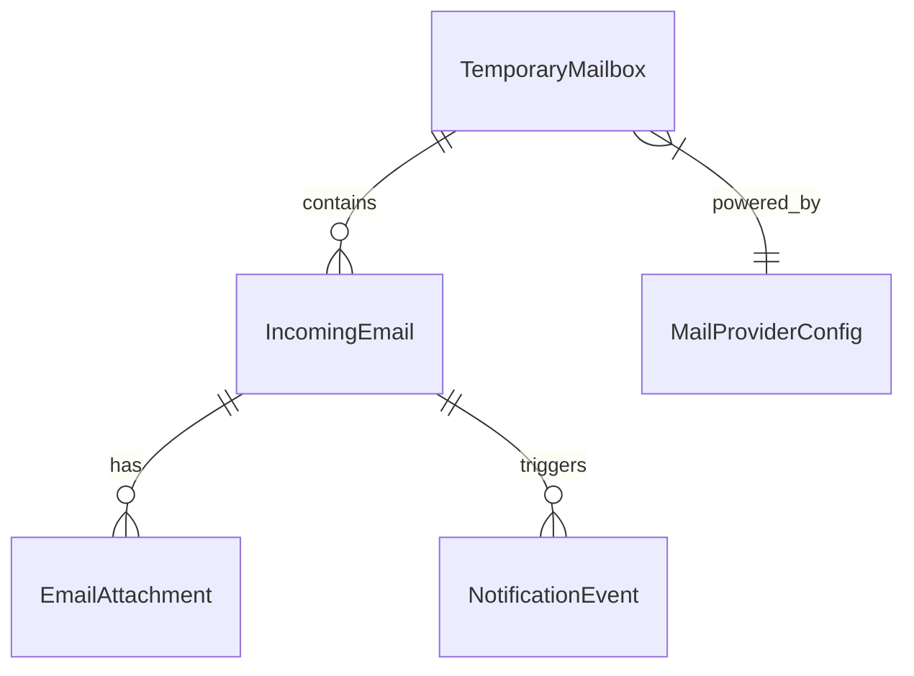
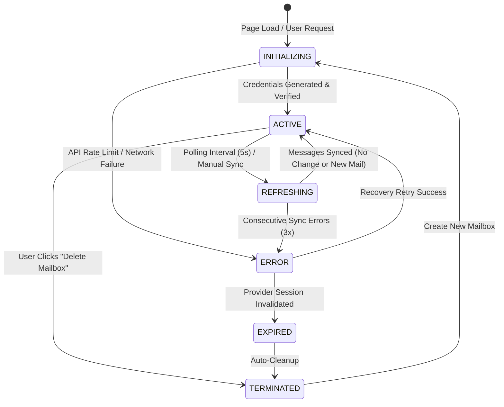
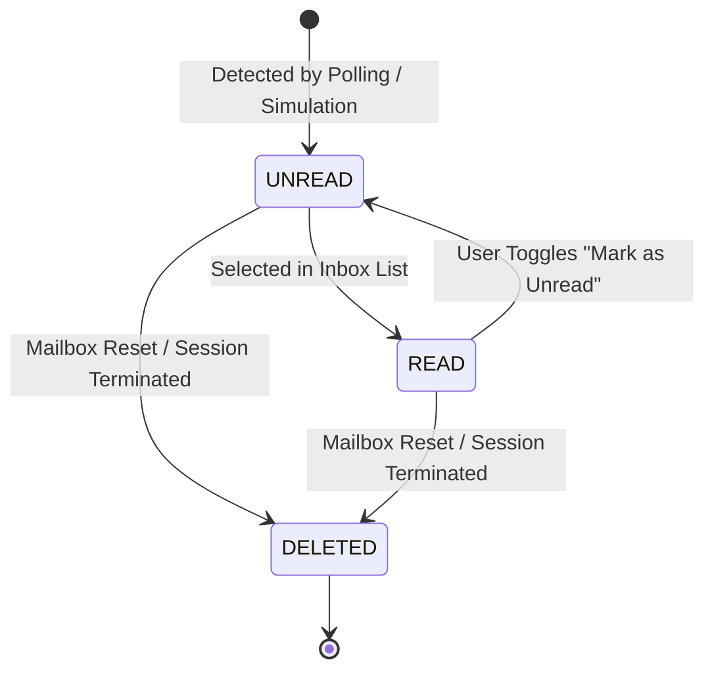

# Data Model: Temporary Disposable Email Service

**Feature**: `001-temp-mail-service` | **Date**: 2026-11-09 | **Status**: Complete

This document defines the core domain entities, attributes, relationships, validation rules, and state machine lifecycles for the TryMail application.

---

## 1. Domain Entities & Interfaces



### 1.1 `TemporaryMailbox`
Represents an active temporary email inbox currently assigned to the user.

| Field | Type | Required | Description | Validation / Constraints |
| :--- | :--- | :---: | :--- | :--- |
| `id` | `string` | Yes | Unique mailbox identifier (UUID or provider ID). | Non-empty string. |
| `address` | `string` | Yes | Full email address (e.g., `alpha99@tmpmail.org`). | Valid RFC 5322 email syntax. |
| `domain` | `string` | Yes | Domain segment of the address. | Must match one of the provider's active domains. |
| `providerId` | `ProviderType` | Yes | Identifier of the backing provider. | `'mailtm' \| 'onesecmail' \| 'mock'` |
| `token` | `string \| null` | No | Authentication token (if required by provider API). | Base64 / JWT string. |
| `createdAt` | `string (ISO)` | Yes | Timestamp when the mailbox was provisioned. | Valid ISO 8601 date-time string. |
| `expiresAt` | `string \| null`| No | Timestamp when the mailbox expires. | Must be > `createdAt` if present. |
| `status` | `MailboxStatus` | Yes | Lifecycle status of the mailbox. | `'INITIALIZING' \| 'ACTIVE' \| 'EXPIRED' \| 'ERROR'` |

---

### 1.2 `IncomingEmail`
Represents an individual message received within an active temporary mailbox.

| Field | Type | Required | Description | Validation / Constraints |
| :--- | :--- | :---: | :--- | :--- |
| `id` | `string` | Yes | Unique identifier of the message. | Non-empty string. |
| `mailboxId` | `string` | Yes | Reference to the owning `TemporaryMailbox`. | Foreign key to `TemporaryMailbox.id`. |
| `senderAddress` | `string` | Yes | Originating sender's email address. | Cleaned email string. |
| `senderName` | `string` | Yes | Display name of the sender (or fallback to address). | Defaults to address if name empty. |
| `subject` | `string` | Yes | Subject line of the email. | Defaults to `"(No Subject)"` if blank. |
| `receivedAt` | `string (ISO)` | Yes | Timestamp when the message arrived. | Valid ISO 8601 date-time string. |
| `textContent` | `string` | Yes | Plain-text representation of message body. | Raw text string. |
| `htmlContent` | `string` | Yes | Sanitized HTML representation of message body. | Must pass DOMPurify XSS filter. |
| `isRead` | `boolean` | Yes | Read/unread flag for badge counting. | Default `false`. |
| `attachments` | `EmailAttachment[]` | Yes | List of attached files. | Empty array if no attachments. |

---

### 1.3 `EmailAttachment`
Represents a file attached to an incoming email message.

| Field | Type | Required | Description | Validation / Constraints |
| :--- | :--- | :---: | :--- | :--- |
| `id` | `string` | Yes | Unique attachment identifier. | Non-empty string. |
| `filename` | `string` | Yes | Name of the file including extension. | Sanitized file name string. |
| `contentType` | `string` | Yes | MIME type of the file. | Valid MIME format (e.g., `application/pdf`). |
| `sizeBytes` | `number` | Yes | File size in bytes. | Integer $\ge 0$. |
| `downloadUrl` | `string` | Yes | URL to retrieve or download the file. | Valid HTTP/HTTPS or Blob URL. |

---

### 1.4 `MailProviderConfig`
Configuration descriptor for supported email backends.

| Field | Type | Required | Description | Validation / Constraints |
| :--- | :--- | :---: | :--- | :--- |
| `id` | `ProviderType` | Yes | Unique provider key. | `'mailtm' \| 'onesecmail' \| 'mock'` |
| `name` | `string` | Yes | Human-readable name. | e.g., `"Mail.tm"`, `"1SecMail"`, `"Mock Offline"` |
| `isOffline` | `boolean` | Yes | Whether the provider operates without internet. | `true` for Mock, `false` for live APIs. |
| `supportsSSE` | `boolean` | Yes | Whether the provider supports push streams. | Boolean flag. |
| `defaultDomain` | `string` | Yes | Preferred domain for new mailboxes. | Non-empty string. |

---

## 2. State Machines & Lifecycles

### 2.1 Mailbox Lifecycle State Machine



### 2.2 Email Message State Machine



---

## 3. Storage & Session Schema (Browser `sessionStorage`)

To ensure persistence across page refreshes within the same browser tab without leaking data across sessions, the active session is stored under the centralized key `TRYMAIL_SESSION_V1`:

```json
{
  "mailbox": {
    "id": "6730a1b2c3d4e5",
    "address": "testuser9812@mailtm.org",
    "domain": "mailtm.org",
    "providerId": "mailtm",
    "token": "eyJhbGciOiJIUzI1NiIsInR5cCI6IkpXVCJ9...",
    "createdAt": "2026-11-09T14:15:00.000Z",
    "expiresAt": null,
    "status": "ACTIVE"
  },
  "inbox": [
    {
      "id": "msg_001",
      "mailboxId": "6730a1b2c3d4e5",
      "senderAddress": "no-reply@github.com",
      "senderName": "GitHub",
      "subject": "Your verification code is 481920",
      "receivedAt": "2026-11-09T14:16:30.000Z",
      "textContent": "Please enter 481920 to verify your account.",
      "htmlContent": "<p>Please enter <strong>481920</strong> to verify your account.</p>",
      "isRead": false,
      "attachments": []
    }
  ],
  "preferences": {
    "soundEnabled": true,
    "tabBadgeEnabled": true,
    "autoRefreshIntervalMs": 5000
  }
}
```

