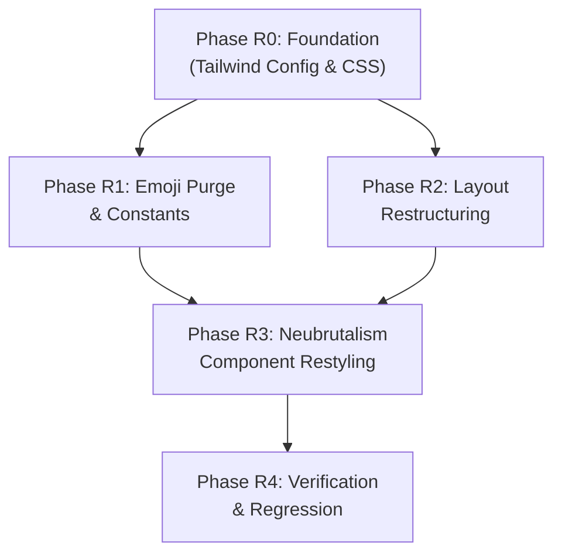

# Implementation Plan: TryMail Neubrutalism UI Redesign

**Feature**: `001-temp-mail-service` (UI Redesign Iteration)  
**Date**: 2026-11-09  
**Status**: Active  
**Branch**: `001-temp-mail-service`

---

## Constitution Compliance Check

| Principle | Impact | Status |
|---|---|---|
| I. Clean Architecture & Separation of Concerns | No changes to `src/services/` or pattern logic. Only presentation layer (`src/components/`, `src/index.css`, `tailwind.config.js`, `src/App.tsx`) is modified. | PASS |
| II. Design Pattern Fidelity (Adapter, Facade, Observer) | Zero changes to GoF pattern classes. | PASS |
| III. TypeScript-First & Strict Type Safety | No type changes. Some component props may gain/lose optional fields (e.g., `ActionToolbar` removes `isChanging` and `onChangeAddress`). All strictly typed. | PASS |
| IV. Deterministic & Testable Multi-Provider Support | No changes to provider logic. Emoji removal from ProviderSelector options is cosmetic only. | PASS |
| V. Security & Safe Content Rendering | DOMPurify sanitizer unchanged. EmailDetailModal HTML rendering remains identical. | PASS |
| React Standards: Centralized Constants | Emoji-containing constants updated in `constants.ts`. No new magic numbers. | PASS |
| React Standards: Component & Layout Agnosticism | Components remain dumb/presentational with `className` prop support via `clsx`/`tailwind-merge`. No outer margins. | PASS |

**Gate Result**: All principles satisfied. Redesign is purely presentational.

---

## Technical Context

| Aspect | Detail |
|---|---|
| **Framework** | React 18 + TypeScript + Vite |
| **Styling** | Tailwind CSS 3.4 (utility-first) |
| **Icon Library** | Lucide React (SVG icons, no emoji) |
| **Components Affected** | 9 files: `index.css`, `tailwind.config.js`, `constants.ts`, `App.tsx`, `MailboxHeader.tsx`, `ActionToolbar.tsx`, `ProviderSelector.tsx`, `InboxList.tsx` + `EmailCard.tsx`, `EmailDetailModal.tsx`, `ToastContainer.tsx`, `CopyButton.tsx` |
| **Components NOT Affected** | All `src/services/**`, `src/hooks/**`, `src/types/**`, `src/utils/**` |
| **Unknowns** | None — all technologies are already in use. |

---

## Redesign Phases

### Phase R0: Foundation (Tailwind Config & Global Styles)
Update the Tailwind configuration and global CSS to establish neubrutalism design tokens (colors, shadow utilities, font weight defaults). Switch the page body from dark mode to a light cream background.

**Artifacts**: `tailwind.config.js`, `src/index.css`

### Phase R1: Emoji Purge & Constants Cleanup
Remove all emoji characters from UI-facing strings in `constants.ts` and component code. Replace functional emoji in `ProviderSelector` options with text-only labels.

**Artifacts**: `src/library/constants.ts`, `src/components/ProviderSelector.tsx`

### Phase R2: Layout Restructuring (Button Relocation)
Move the "Change Address" button from `ActionToolbar` into `MailboxHeader` (next to "Copy Address"). Simplify `ActionToolbar` to only "Refresh Inbox" and "Delete Mailbox". Update `App.tsx` wiring accordingly.

**Artifacts**: `src/components/MailboxHeader.tsx`, `src/components/ActionToolbar.tsx`, `src/App.tsx`

### Phase R3: Neubrutalism Component Restyling
Apply neubrutalism visual treatment to every component: thick black borders, hard offset shadows, solid bright backgrounds, bold typography, press-in hover effects. Ensure responsive behavior at all breakpoints.

**Artifacts**: `src/App.tsx`, `src/components/MailboxHeader.tsx`, `src/components/ActionToolbar.tsx`, `src/components/CopyButton.tsx`, `src/components/EmailCard.tsx`, `src/components/InboxList.tsx`, `src/components/EmailDetailModal.tsx`, `src/components/ToastContainer.tsx`, `src/components/ProviderSelector.tsx`

### Phase R4: Verification & Regression
Run full build, typecheck, and automated test suite. Verify all redesign quickstart scenarios and confirm zero functional regressions.

**Artifacts**: Build output, test results

---

## Phase Dependencies

- **R0** is the foundation — must complete first (design tokens).
- **R1** and **R2** are independent of each other but both depend on R0.
- **R3** depends on both R1 and R2 (needs clean constants and correct layout before full restyling).
- **R4** runs last to verify everything.

---

## Generated Artifacts

| Artifact | Path | Purpose |
|---|---|---|
| Redesign Research | `specs/001-temp-mail-service/redesign-research.md` | Neubrutalism design decisions, color palette, layout diagrams |
| Redesign Quickstart | `specs/001-temp-mail-service/redesign-quickstart.md` | Visual validation scenarios for the redesigned UI |
| Redesign Plan | `specs/001-temp-mail-service/redesign-plan.md` | This document — phased implementation plan |

