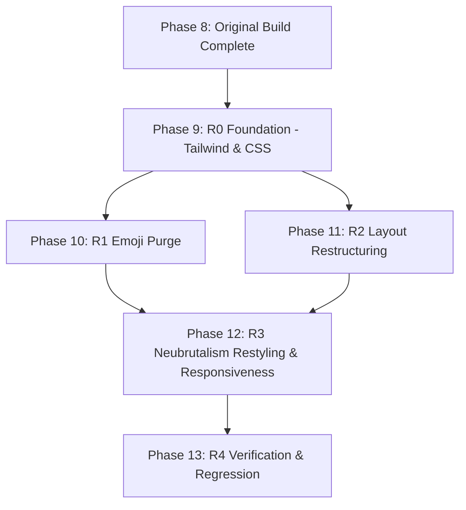

# Tasks: Temporary Disposable Email Service (Temp Mail)

**Input**: Design documents from `/specs/001-temp-mail-service/` (`plan.md`, `spec.md`, `research.md`, `data-model.md`, `contracts/`, `quickstart.md`, `redesign-plan.md`, `redesign-research.md`, `redesign-quickstart.md`)

**Prerequisites**: `plan.md` (required), `spec.md` (required for user stories), `research.md`, `data-model.md`, `contracts/`, `redesign-plan.md`

**Organization**: Tasks are grouped by user story and iterative delivery phases to enable independent implementation and testing.

## Format: `- [ ] [ID] [P?] [Story] Description with file path`

- **[P]**: Can run in parallel (different files, no dependencies on incomplete tasks)
- **[Story]**: Which user story or phase this task belongs to (`[US1]`, `[US2]`, `[US3]`, `[US4]`, `[US5]`, `[Redesign]`)
- Include exact file paths in all descriptions

---

## Phase 1: Setup (Shared Infrastructure)

**Purpose**: Project initialization, dependency installation, and baseline configuration

- [X] T001 Initialize Vite React TypeScript project with `package.json`, `tsconfig.json`, and `vite.config.ts` at repository root
- [X] T002 Install project runtime dependencies (`@tanstack/react-query`, `dompurify`, `@types/dompurify`, `lucide-react`, `clsx`, `tailwind-merge`) and dev dependencies (`tailwindcss`, `postcss`, `autoprefixer`, `vitest`, `@testing-library/react`) in `package.json`
- [X] T003 [P] Configure Tailwind CSS and PostCSS in `tailwind.config.js` and base style directives in `src/index.css`
- [X] T004 [P] Setup centralized application constants (API URLs, polling intervals, session storage keys `TRYMAIL_SESSION_V1`, default provider `mock`) in `src/library/constants.ts`
- [X] T005 [P] Define TypeScript domain models and enums (`TemporaryMailbox`, `IncomingEmail`, `EmailAttachment`, `MailProviderConfig`, `MailboxStatus` enum `'INITIALIZING' | 'ACTIVE' | 'EXPIRED' | 'ERROR'`, `ProviderType` `'mailtm' | 'onesecmail' | 'mock'`) in `src/types/mailbox.types.ts` and `src/types/email.types.ts`

---

## Phase 2: Foundational (Blocking Prerequisites - Design Pattern Core & Infrastructure)

**Purpose**: Core architectural contracts and services that MUST be completed before ANY user story can be implemented

**CRITICAL**: No user story work can begin until this phase is complete

- [X] T006 [P] Implement `ITempMailProvider` target interface per `contracts/provider-adapter.contract.ts` in `src/services/adapter/ITempMailProvider.ts`
- [X] T007 [P] Implement `MockMailAdapter` with pre-seeded domains and synthetic message generation in `src/services/adapter/MockMailAdapter.ts`
- [X] T008 [P] Implement `IMailEventListener` contract and `MailEventManager` Subject/Publisher in `src/services/observer/MailEventManager.ts` per `contracts/observer.contract.ts`
- [X] T009 Implement foundational `TempMailFacade` class managing active provider selection and event manager dispatch in `src/services/facade/TempMailFacade.ts`
- [X] T010 [P] Implement DOMPurify sanitization utility with script-stripping and `target="_blank" rel="noopener noreferrer"` link transformation in `src/utils/sanitizer.ts`
- [X] T011 Configure TanStack `QueryClientProvider` and root application shell in `src/main.tsx` and `src/App.tsx`

**Checkpoint**: Core design pattern contracts and infrastructure ready — user story implementation can now begin.

---

## Phase 3: User Story 1 - Instant Mailbox Generation & One-Click Copy (Priority: P1) - MVP

**Goal**: Users automatically receive an active disposable email address immediately on application startup and can copy it with a single click.

**Independent Test**: Load the application in a web browser, verify an active email address appears within 3 seconds, click the copy button, and verify that pasting yields the exact displayed address with a 2-second "Copied!" confirmation.

### Implementation for User Story 1

- [X] T012 [US1] Implement `createNewMailbox()` and `restoreSession()` with `sessionStorage` persistence in `src/services/facade/TempMailFacade.ts`
- [X] T013 [US1] Implement `useTempMail` custom hook in `src/hooks/useTempMail.ts` to bridge Facade mailbox provisioning with React lifecycle
- [X] T014 [P] [US1] Create layout-agnostic `CopyButton` component in `src/components/CopyButton.tsx` with animated clipboard icon and "Copied!" visual feedback
- [X] T015 [US1] Create `MailboxHeader` component in `src/components/MailboxHeader.tsx` displaying the current email address, active provider badge, and `CopyButton`
- [X] T016 [US1] Integrate `MailboxHeader` into `src/App.tsx` and verify automatic mailbox initialization and clipboard copy functionality

**Checkpoint**: User Story 1 is fully functional and delivers an independently testable MVP.

---

## Phase 4: User Story 2 - Real-time Incoming Message Reception & Notification (Priority: P1)

**Goal**: Incoming emails are detected automatically via background synchronization, updating the inbox list and triggering audio chime, tab title badge, and toast notifications.

**Independent Test**: Trigger an incoming email via the mock provider simulation; verify the message appears in the inbox list within 5 seconds, an audible chime plays, and the browser tab title displays `(1) New Email | TryMail`.

### Implementation for User Story 2

- [X] T017 [P] [US2] Implement `AudioAlertListener` in `src/services/observer/listeners/AudioAlertListener.ts` synthesizing a notification chime via browser Web Audio API
- [X] T018 [P] [US2] Implement `TabTitleBadgeListener` in `src/services/observer/listeners/TabTitleBadgeListener.ts` updating the document title with unread count
- [X] T019 [P] [US2] Implement `ToastNotificationListener` in `src/services/observer/listeners/ToastNotificationListener.ts` dispatching toast alert events
- [X] T020 [US2] Implement `syncInbox()` in `src/services/facade/TempMailFacade.ts` to query messages, detect newly arrived IDs, and broadcast `EMAIL_RECEIVED` events
- [X] T021 [US2] Implement `useMailObserver` hook in `src/hooks/useMailObserver.ts` registering audio, title, and toast listeners on mount and unsubscribing on unmount
- [X] T022 [P] [US2] Create `EmailCard` row component in `src/components/EmailCard.tsx` showing sender name, subject, relative timestamp, and unread indicator dot
- [X] T023 [US2] Create `InboxList` component in `src/components/InboxList.tsx` with empty state placeholder and scrollable message card list
- [X] T024 [P] [US2] Create `ToastContainer` component in `src/components/ToastContainer.tsx` to render floating toast popups in the bottom-right corner
- [X] T025 [US2] Integrate `InboxList`, `ToastContainer`, and `useMailObserver` into `src/App.tsx` and verify automated background polling via TanStack Query

**Checkpoint**: User Stories 1 and 2 work seamlessly together with live event-driven notifications.

---

## Phase 5: User Story 3 - Message Inspection & Safe Content Viewing (Priority: P2)

**Goal**: Users can select an email from the inbox list to read full details with sanitized rich HTML, safe external links, and automatic read state transition.

**Independent Test**: Select an unread email from the list; verify the detail panel opens, message body renders sanitized HTML safely, links open with `target="_blank"`, and the unread count decrements.

### Implementation for User Story 3

- [X] T026 [US3] Implement `openEmail(messageId)` in `src/services/facade/TempMailFacade.ts` to fetch message details, sanitize HTML content, and mark `isRead = true`
- [X] T027 [P] [US3] Implement date formatting and byte size calculation utilities in `src/utils/formatters.ts`
- [X] T028 [US3] Create `EmailDetailModal` component in `src/components/EmailDetailModal.tsx` displaying sender, timestamp, subject, sanitized body, and attachment download links
- [X] T029 [US3] Wire email selection state in `src/App.tsx` and synchronize selected message ID with URL query parameter `?mailId=...`

**Checkpoint**: User Story 3 is complete; users can safely inspect email details.

---

## Phase 6: User Story 4 - Mailbox Lifecycle Controls (Refresh, Reset, Delete) (Priority: P2)

**Goal**: Users have explicit controls to trigger manual inbox checks, generate a new replacement address, or delete the mailbox session.

**Independent Test**: Click manual refresh to observe immediate sync spinner; click "Change Address" to verify previous session is purged and a new address is provisioned.

### Implementation for User Story 4

- [X] T030 [US4] Implement `disposeCurrentMailbox()` in `src/services/facade/TempMailFacade.ts` to clear `sessionStorage` and notify `MAILBOX_DELETED`
- [X] T031 [US4] Create `ActionToolbar` component in `src/components/ActionToolbar.tsx` with "Refresh", "Change Address", and "Delete Mailbox" action buttons
- [X] T032 [US4] Integrate `ActionToolbar` into `src/App.tsx` and verify manual synchronization and mailbox reset workflows

**Checkpoint**: Full user control over mailbox lifecycle is established.

---

## Phase 7: User Story 5 - Multi-Provider Mailbox Fallback & Switching (Priority: P3)

**Goal**: Users can switch between Mail.tm, 1secmail, and MockMail providers, and trigger instant synthetic email generation in mock mode.

**Independent Test**: Select "Mail.tm" from provider dropdown, verify new email address with Mail.tm domain is created; switch back to "Mock Mail" and click "Simulate Email" to verify instant receipt.

### Implementation for User Story 5

- [X] T033 [US5] Implement `MailTmAdapter` adhering to `ITempMailProvider` in `src/services/adapter/MailTmAdapter.ts`
- [X] T034 [US5] Implement `OneSecMailAdapter` adhering to `ITempMailProvider` in `src/services/adapter/OneSecMailAdapter.ts`
- [X] T035 [US5] Implement `switchProvider()` and `simulateIncomingEmail()` in `src/services/facade/TempMailFacade.ts`
- [X] T036 [US5] Create `ProviderSelector` dropdown and "Simulate Incoming Email" action button in `src/components/ProviderSelector.tsx`
- [X] T037 [US5] Integrate `ProviderSelector` into `src/components/MailboxHeader.tsx` and `src/App.tsx`

**Checkpoint**: All 5 user stories are completely implemented and integrated.

---

## Phase 8: Polish & Cross-Cutting Concerns

**Purpose**: Automated testing, TypeScript verification, performance validation, and academic documentation

- [X] T038 [P] Implement unit tests for `MockMailAdapter`, `TempMailFacade`, and `MailEventManager` in `tests/unit/services.test.ts`
- [X] T039 [P] Implement XSS sanitization unit tests verifying script elimination in `tests/unit/sanitizer.test.ts`
- [X] T040 Verify strict TypeScript compilation with zero errors via `npm run typecheck` (`tsc --noEmit`)
- [X] T041 Execute full end-to-end quickstart validation scenarios per `quickstart.md`
- [X] T042 [P] Update project `README.md` with GoF design pattern architecture diagrams (Adapter, Facade, Observer), setup commands, and project report summary

---

## Neubrutalism UI Redesign Iteration

**Input**: Design documents from `/specs/001-temp-mail-service/` (`redesign-plan.md`, `redesign-research.md`, `redesign-quickstart.md`)

---

## Phase 9: Redesign Foundation (Tokens & Global Styles - Phase R0)

**Purpose**: Establish Neubrutalism design tokens in Tailwind and switch global CSS from dark slate to light brutalist theme

- [X] T043 [P] [Redesign] Extend Tailwind configuration with Neubrutalism box-shadows (`brutal`, `brutal-sm`, `brutal-lg`), brutal borders, and vibrant solid color palette in `tailwind.config.js`
- [X] T044 [P] [Redesign] Update global styles in `src/index.css` to switch background from `#0f172a` to cream `#fffdf7`, enable sharp contrast text, and configure high-contrast selection styles

**Checkpoint**: Neubrutalism design tokens and base canvas ready.

---

## Phase 10: Emoji & Emoticon Purge (Phase R1)

**Purpose**: Eliminate all decorative emoticons and Unicode emojis from code constants, selector options, and documentation

- [X] T045 [P] [Redesign] Purge decorative emoji characters from notification titles and default string constants in `src/library/constants.ts`
- [X] T046 [P] [Redesign] Remove emoji indicators from provider options and replace with clean semantic text in `src/components/ProviderSelector.tsx`
- [X] T047 [P] [Redesign] Remove decorative emojis from documentation headers and status badges in `README.md` and `specs/001-temp-mail-service/tasks.md`

**Checkpoint**: Application and documentation are 100% emoticon-free.

---

## Phase 11: Layout Restructuring - Button Relocation (Phase R2)

**Purpose**: Move "Change Address" to the header alongside "Copy Address" and simplify `ActionToolbar` to only "Refresh Inbox" and "Delete Mailbox"

- [X] T048 [Redesign] Add "Change Address" action button adjacent to the "Copy Address" button in `src/components/MailboxHeader.tsx`
- [X] T049 [Redesign] Refactor `ActionToolbar` to remove the "Change Address" button, keeping exclusively "Refresh Inbox" and "Delete Mailbox" in `src/components/ActionToolbar.tsx`
- [X] T050 [Redesign] Update component wiring and action callbacks in `src/App.tsx` to support the new header and toolbar layout

**Checkpoint**: Address actions are unified in the header card, and lifecycle actions are streamlined in the toolbar.

---

## Phase 12: Neubrutalism Component Restyling & Responsiveness (Phase R3)

**Purpose**: Apply thick black borders, hard offset shadows, vibrant solid fills, bold typography, and mobile-first responsiveness across all UI components

- [X] T051 [P] [Redesign] Restyle `CopyButton` with solid fill, `border-2 border-black`, hard offset shadow `shadow-[2px_2px_0px_0px_#000]`, and press-in hover effect in `src/components/CopyButton.tsx`
- [X] T052 [P] [Redesign] Restyle `ProviderSelector` with brutal select wrapper, `border-2 border-black`, hard shadow, and responsive mobile wrap in `src/components/ProviderSelector.tsx`
- [X] T053 [Redesign] Restyle `MailboxHeader` with brutalist card (`border-2 border-black`, `shadow-[4px_4px_0px_0px_#000]`, bright pastel accent badges, bold monospace address, responsive stacking) in `src/components/MailboxHeader.tsx`
- [X] T054 [Redesign] Restyle `ActionToolbar` with brutalist 2-button bar (`border-2 border-black`, `shadow-[4px_4px_0px_0px_#000]`, high-contrast buttons, responsive full-width mobile stack) in `src/components/ActionToolbar.tsx`
- [X] T055 [P] [Redesign] Restyle `EmailCard` message row item with `border-2 border-black`, hard shadow hover, unread contrast badge, and touch-friendly mobile spacing in `src/components/EmailCard.tsx`
- [X] T056 [Redesign] Restyle `InboxList` container with brutal card styling, bold header counter badge, brutal audio toggle switch, and responsive empty state placeholder in `src/components/InboxList.tsx`
- [X] T057 [Redesign] Restyle `EmailDetailModal` with windowed brutal dialog (`border-[3px] border-black`, `shadow-[8px_8px_0px_0px_#000]`, bold window header, high-contrast tabs, safe sanitized body container, responsive padding) in `src/components/EmailDetailModal.tsx`
- [X] T058 [P] [Redesign] Restyle `ToastContainer` and floating toast alerts with brutalist notification cards (`border-2 border-black`, `shadow-[4px_4px_0px_0px_#000]`, solid yellow/lime fill, responsive positioning) in `src/components/ToastContainer.tsx`
- [X] T059 [Redesign] Restyle `App.tsx` application shell (neubrutalism header title, pattern badges with `border-2 border-black` and solid pastel fills, observer simulation banner, responsive container padding, footer) in `src/App.tsx`

**Checkpoint**: Complete Neubrutalism visual design system applied across all components with full mobile responsiveness.

---

## Phase 13: Redesign Verification & Regression Testing (Phase R4)

**Purpose**: Ensure zero regressions in GoF patterns, strict TypeScript compilation, unit test suite pass, and quickstart visual validation

- [X] T060 [Redesign] Execute automated test suite (`npm test`) verifying all 16 unit tests continue passing without regression in `tests/unit/`
- [X] T061 [Redesign] Verify strict TypeScript compilation with zero errors via `npm run typecheck` (`tsc --noEmit`)
- [X] T062 [Redesign] Execute production build verification via `npm run build` to confirm asset bundling and minification
- [X] T063 [Redesign] Validate redesign scenarios R1 through R5 per `specs/001-temp-mail-service/redesign-quickstart.md`
- [X] T064 [P] [Redesign] Update project documentation in `README.md` to reflect the Neubrutalism design system and updated UI layout

---

## Phase 14: Bug Fixes & Toolbar Consolidation (Phase R5)

**Purpose**: Consolidate simulation button into ActionToolbar, fix Mock Mail delete inbox reset, and fix simulation state restoration

- [X] T065 [Redesign] Integrate "Simulate Incoming Email" into `ActionToolbar` conditionally for offline mock provider in `src/components/ActionToolbar.tsx`
- [X] T066 [Redesign] Remove standalone simulation banner from `src/App.tsx` and wire simulation handler directly into `ActionToolbar`
- [X] T067 [Redesign] Fix mailbox deletion in `src/services/adapter/MockMailAdapter.ts` by ensuring newly created mailboxes start with an empty inbox
- [X] T068 [Redesign] Fix simulation failure after session restore by syncing restored session state into `MockMailAdapter` and properly awaiting sync in `src/services/facade/TempMailFacade.ts`
- [X] T069 [Redesign] Run full test suite and TypeScript check to verify zero regressions across all GoF services

---

## Dependencies & Execution Order

### Redesign Phase Dependencies



- **Phase 9 (R0 Foundation)**: Can start immediately.
- **Phase 10 (R1 Emoji Purge)**: Can start after Phase 9.
- **Phase 11 (R2 Layout Restructuring)**: Can start after Phase 9 in parallel with Phase 10.
- **Phase 12 (R3 Component Restyling)**: Depends on Phase 10 & Phase 11.
- **Phase 13 (R4 Verification)**: Runs after all redesign components are styled.

---

## Parallel Execution Opportunities

```bash
# Phase 9: Tokens and CSS
Task: "T043 Extend Tailwind configuration with Neubrutalism tokens in tailwind.config.js"
Task: "T044 Update global styles in src/index.css"

# Phase 10: Emoji Purge
Task: "T045 Purge emoji characters in src/library/constants.ts"
Task: "T046 Remove emoji indicators in src/components/ProviderSelector.tsx"
Task: "T047 Remove emojis in README.md and tasks.md"

# Phase 12: Independent Dumb Components Restyling
Task: "T051 Restyle CopyButton in src/components/CopyButton.tsx"
Task: "T052 Restyle ProviderSelector in src/components/ProviderSelector.tsx"
Task: "T055 Restyle EmailCard in src/components/EmailCard.tsx"
Task: "T058 Restyle ToastContainer in src/components/ToastContainer.tsx"
```
